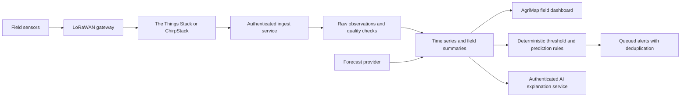

# Plantation weather and camera integration

This is an implementation plan, not a claim that hardware or external services are connected. The demo uses sample data. The existing camera matrix now uses the HLS adapter; a gateway is still required. Device availability, current manufacturer specifications, prices, and regional radio approval must be checked before ordering. Official Dragino and Open-Meteo documentation was blocked by this environment's network policy during this review.

## A practical first deployment

Begin with one outdoor LoRaWAN gateway, three temperature/humidity measurement locations, one calibrated rain gauge, and one soil-moisture station. Put locations in the coldest low-lying area, a representative crop block, and a higher or exposed area. Expand after comparing readings with a reference instrument and measuring radio coverage.

| Measurement | Suitable equipment class | Selection and installation notes |
| --- | --- | --- |
| Air temperature and relative humidity | Outdoor LoRaWAN combined temperature/RH sensor, with a replaceable calibrated probe | Consider a Dragino outdoor temperature/RH model or a Decentlab DL-SHT35 class device. Confirm the exact SKU supports both measurements. Use a ventilated radiation shield; an IP rating does not prevent solar heating errors. |
| Canopy frost temperature | Waterproof temperature probes such as the Dragino D20S-LB | D20S-LB is a temperature-sensor candidate, not a complete humidity/rainfall station. Verify the probe count, temperature range, calibration and radio region. Put a canopy probe near vulnerable blossoms, in addition to shielded reference air measurements. |
| Rainfall amount and intensity | Calibrated tipping-bucket rain gauge with LoRaWAN pulse-counter node | A rain-detection switch only tells you wet/dry; it cannot measure millimeters. Confirm pulse debounce, resolution, maximum intensity, counter persistence, and reset handling. Install level, with suitable clearance and routine cleaning. |
| Soil moisture, temperature and conductivity | Agricultural LoRaWAN soil probe; candidates include Dragino LSE01 or Milesight EM500-SMTC classes | Verify supported measurements and calibration for the actual soil. Place probes at representative root-zone depths. Conductivity is not a direct nutrient measurement. |
| Leaf wetness | Dedicated leaf-wetness probe with a compatible LoRaWAN node | Useful for disease-risk windows. Relative humidity alone cannot establish leaf wetness. Install according to sensor guidance near the crop canopy. |
| Wind, pressure and solar radiation | Reference weather station or professional RS485/SDI-12 sensors plus a compatible data logger | Begin with wind if spray planning is important. Solar radiation improves evapotranspiration estimates. A multi-sensor station is easier to install centrally, while distributed nodes reveal field microclimates. |

A mains-powered industrial eight-channel LoRaWAN gateway is preferable to a single-channel hobby receiver. Candidates include industrial Milesight gateways, RAK gateways, or Dragino DLOS8-class gateways; choose the exact outdoor rating, Ethernet/4G options, antenna, power requirements and regional frequency after a site survey. Add surge protection, grounding, weatherproof cable glands and UPS power. Gateway range depends on terrain, canopy, antenna height and interference; do not design around an advertised maximum distance. Use LoRaWAN for small telemetry packets, not camera video.

Use Ethernet where available, or a local SIM/4G router with a suitable antenna. Remote locations without reliable backhaul need store-and-forward, enough power for the gateway/router, and a clear offline-alarm policy. Battery node reporting every 5–15 minutes is a starting point; frost monitoring may need faster sampling and threshold-triggered transmission. Verify actual battery life and radio airtime rather than assuming headline lifetimes apply.

## Data flow

Register each node's device identity, OTAA join configuration and regional channel plan in the network server. Keep join keys and integration credentials in the server's secret store. The browser should never receive them.

An ingest service must verify the provider's webhook authentication, decode the payload with the manufacturer's versioned decoder, look up the station-to-organization binding on the server, and ignore any tenant identity supplied by an untrusted payload. Use an idempotency key based on provider, device ID and uplink counter/session to avoid duplicate measurements. Persist raw payloads and decoder versions before normalization.

Normalized observations should include stationId, organizationId, measuredAt, receivedAt, coordinates/elevation, temperatureC, humidityPct, rainfallIncrementMm, batteryV, RSSI/SNR, quality flags and calibration metadata. Not every sensor supports every field. Never replace missing data with zero. Quarantine implausible readings, counter resets, out-of-order packets and future timestamps. Store observation timestamps in UTC and report periods using each farm's IANA timezone.

The added `src/services/weatherData.ts` provides basic validation, stale-reading status, per-tenant/per-station summaries and a validated forecast URL builder. It is a foundation, not an ingest server. Its summary uses sample means, not time-weighted daily means. Production reports need expected-sample coverage, gap handling, calibrated rainfall counter-to-increment conversion and proper time-weighted aggregates.

Firestore can hold latest station status and small daily summaries. For dense long-term observations, evaluate PostgreSQL/TimescaleDB, another time-series database, or object storage plus scheduled analytics before placing every measurement into Firebase. Model retention and read/write costs based on node count and reporting interval.

## Forecasts, analysis and alerts

Open-Meteo is a reasonable forecast-provider candidate, with OpenWeather or another licensed service as alternatives. Check commercial-use terms, attribution, historical-data access and rate limits. Forecast data is modeled data, not plantation observations. Store provider, model, fetchedAt, forecast issuedAt and validAt separately from sensor timestamps. Fetch/cache on the backend, not once per browser or per device.

Useful first metrics: daily minima/maxima, time below crop-stage-specific frost thresholds, humidity/leaf-wetness duration, rainfall totals/intensity, soil-moisture trends, growing degree days and data completeness. Weekly/monthly/annual reports should display missing periods and forecast-versus-observed errors. Different crop varieties require different chill and heat models; choose regionally appropriate models with an agronomist rather than inventing one universal suitability score.

For frost, combine canopy temperature, trends, dew point, wind, forecast minima and crop phenological stage. A reference air sensor cannot guarantee blossom temperatures are safe. Predictive disease tools need actual wetness duration and validated disease/crop models. Irrigation planning can add evapotranspiration and soil water balance once the required calibrated inputs exist.

Start alerts with deterministic configurable rules. Add freshness limits, hysteresis, consecutive-reading requirements, cooldowns, delivery retries and acknowledgement. Stale sensors should create a separate offline alert, not a reassuring green status. Track threshold crossing and recovery so one event does not spam users. Choose email, push or SMS according to urgency and permission. Automated irrigation/frost-protection actuation requires a separate fail-safe design.

Use AI to explain verified summaries, compare scenarios, and prepare seasonal reports with timestamps, source references and uncertainty. Do not make generative AI the sole frost alarm or use it to invent historical readings. Validate recommendations against crop type, cultivar, growth stage, soil and local agronomic knowledge.

## Browser camera multi-view

VLC can play RTSP directly. Standard browser video elements generally cannot. Keep the cameras on a private network; use a local gateway such as [go2rtc](https://github.com/AlexxIT/go2rtc) or [MediaMTX](https://github.com/bluenviron/mediamtx) to expose WebRTC for low latency or HLS for broader playback. The current UI supports HLS. RTSP URLs and camera passwords belong in private gateway configuration, not Firestore profiles or browser code.

The production grid expects same-origin paths such as `/api/cameras/north/index.m3u8`. A reverse proxy must authenticate a server-issued session cookie, authorize the user's organization for each camera and every playlist/segment request, and then proxy the stream to a private media gateway. It must prevent arbitrary upstream URLs, enforce an allowlist of registered camera IDs, and rewrite segment paths appropriately. TLS, exact CORS rules when needed and authorization must apply to all media resources. Do not simply expose a gateway port publicly.

Use H.264 substreams initially, for example lower-resolution feeds for a 2×2 overview, and request the main stream only when one view is enlarged. Nine high-resolution streams can overwhelm Wi-Fi, uplink bandwidth and browser decoding. H.265 often requires transcoding depending on the browser. Use wired PoE where possible, monitor gateway CPU, and test the actual camera model/codecs. WebRTC needs a separate authenticated signaling integration and may require TURN through difficult networks.

The existing camera matrix supports multiple layout sizes, independent error messages and cleanup when switching views. Register each camera's streamSrc with the authenticated media gateway. No camera credentials, gateway address or live feed was supplied, so actual multi-camera playback is unverified.

## Suggested next features

Add a sensor-health map, battery/offline alerts, a station calibration log, field-specific thresholds, forecast accuracy reports, and crop-stage calendars first. Later add weather-linked spray windows, frost-risk maps by elevation, irrigation recommendations, disease-risk timelines and side-by-side seasonal comparisons. Keep sample data visually labelled and in a separate demo route. The registration flow should offer a clean workspace rather than silently importing sample records.

References to verify before purchase: [Dragino product catalogue](https://www.dragino.com/), [Dragino manuals](https://wiki.dragino.com/), [Decentlab](https://www.decentlab.com/), [Milesight agriculture sensors](https://www.milesight.com/iot), [The Things Stack](https://www.thethingsindustries.com/docs/), [ChirpStack](https://www.chirpstack.io/docs/), and [Open-Meteo API documentation](https://open-meteo.com/en/docs).
