# AgriMap Pro — Illustrated User Guide

**English edition · 19 November 2026 · sonik g2.0.1.4**

Application reference: `d71db7253e1268271961776e27c507e586ce2143` on `demo-preview`.

[Open the illustrated HTML guide](index.html) · [Printable PDF](AgriMap-Pro-User-Guide-en.pdf) · [Daily SOP checklists](SOP-CHECKLISTS.md) · [Screenshot provenance](screenshots/manifest.json)

This guide follows the current application, including its existing English menu labels. All screenshots use a fictional **Training Farm · Guria** and fictional people. They are examples, not your plantation or financial records. Screenshots were captured in the Modern UI; Classic shares the business workflows. External map tiles, AI providers and hardware are not connected in the capture environment. A visible configuration panel is not proof of a live device integration.

## 1. Choose your working mode

| Mode | How to enter | Account and data authority | Before you start |
| --- | --- | --- | --- |
| Firebase cloud | Hosted application, or the cloud UI at `http://localhost:3101` when started locally | Firebase account and company memberships | Internet, correct Firebase project and approved company membership |
| Local farm / LAN | `http://localhost:3100/local`, or the farm server's approved LAN URL | Farm server account and SQLite records | Running farm server; owner-created account |
| Offline device | Previously opened supported cloud screens; separate terminal pilot supports its own queue | Cached data is incomplete; permissions and available data depend on previous authentication | Test the exact workflow before leaving coverage |

Cloud and local accounts are separate identities. The same email or username does not automatically join or merge them. **Cloud backup is a manual snapshot, not automatic two-way synchronization.** Do not switch between unrelated workspaces and expect records to combine.

On a prepared computer, start the installed farm with `npm run local:start`. For a fresh installation: install dependencies with `npm ci --include=dev`, build with `npm run build`, initialize a **new** farm once with `npm run local:init`, then start. Use a maintained Node version supporting the application's SQLite runtime. In PowerShell, `npm.cmd` can be used where the `npm.ps1` execution policy blocks npm. Never initialize again to recover a forgotten account or change a farm name.

The startup output gives the actual URLs. Open the local URL for LAN work and the cloud URL for Firebase work. Other tablets need the server's LAN address, not `localhost` (which means the tablet itself). Use the documented HTTPS LAN configuration for non-loopback access and hardware permissions. Keep the server powered on during the shift.

**Check:** confirm farm/company name, user and mode before entering business records. A locally served page may still show legacy “Cloud Mode” wording inside a module; the server banner and account authority determine the actual mode.

## 2. Register and sign in

### Cloud registration

1. Open **Register with Firebase / Register** and select the appropriate account type.
2. Enter your name, email and a strong password. Submit once and wait for the result.
3. Sign in and open your profile. Register a company, request to join one, or complete a public service profile according to your goal.
4. Follow email verification instructions if offered. Company membership is separate from email verification.

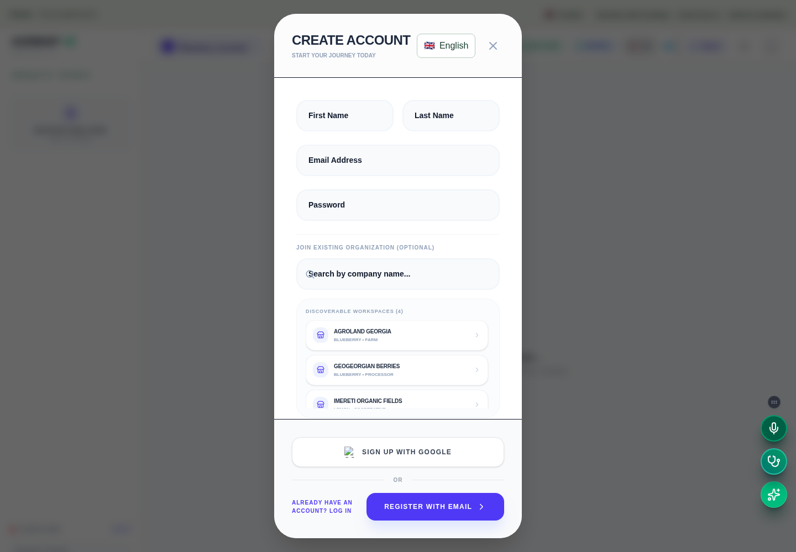

*Cloud registration entry. This screenshot shows the form, not a successful production account creation.*

### Local registration and owner-managed workers

1. The farm owner initializes the server once and signs in with the owner username.
2. Open **Local accounts & records** and scroll to **Add a worker**.
3. Enter **Worker name**, **Worker username** and **Initial password**, then choose **Create worker**.
4. Give the person the farm's correct LAN address and their own credentials through an appropriate private channel.
5. Link the person's account to the correct HR employee record. A similar name alone is not a reliable identity link.

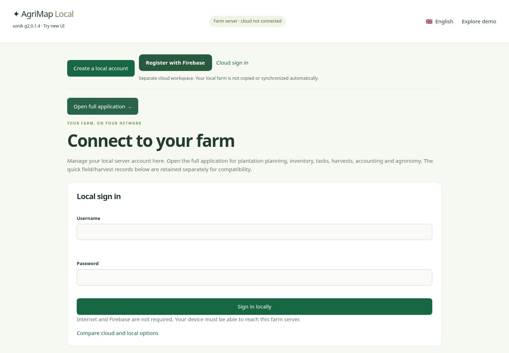

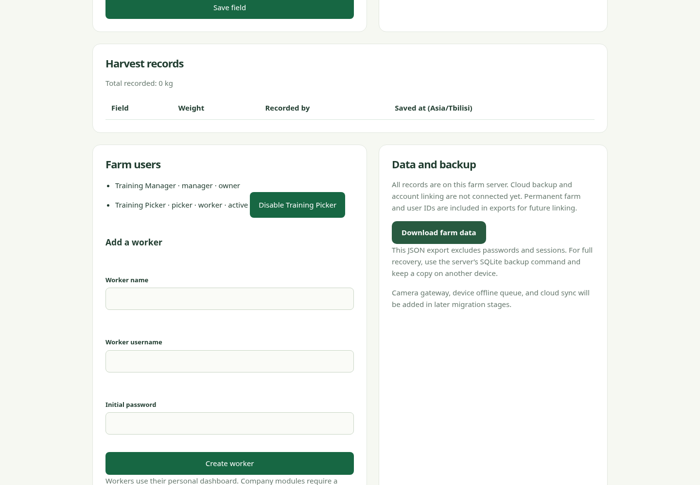

*Local sign-in and owner-managed accounts. Public self-signup and creation of a second farm owner are not local registration workflows in this release.*

**Check:** sign in as the worker and confirm the expected personal workspace. Do not share the owner account with a weighing team. Recover an existing account before creating another one for the same person.

## 3. Profile, verification, services and agro-agents

### Maintain your personal profile

1. Open your account/profile menu.
2. Review your name, contact details, region and organization membership.
3. In **My work & earnings**, expand **My CV, services & reviews**.
4. Add skills, experience, offered services and working regions. Keep availability current.
5. Enable public discovery only if you want companies and potential partners to find your service profile. Save and reopen to confirm it persisted.

**Check:** distinguish your private work/payroll history from public profile fields. Never add passwords, identity documents or bank details to public CV/free-text fields.

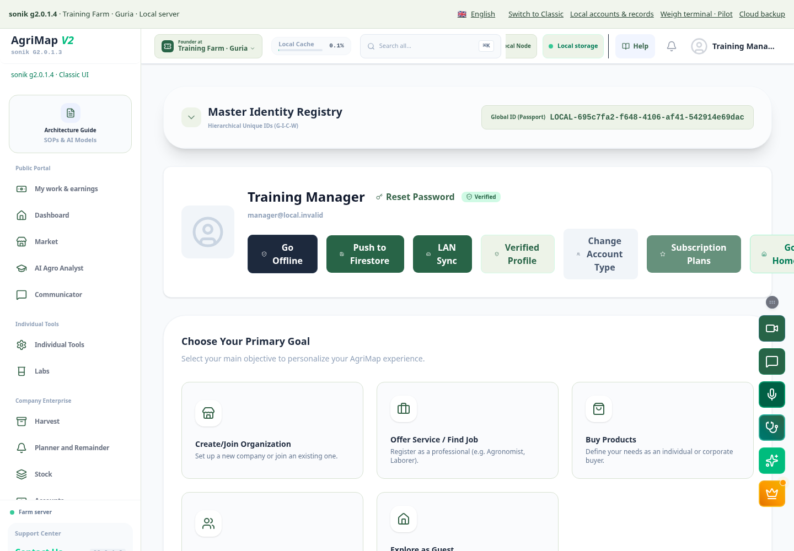

### Verification: what the current screen means

The legacy profile offers **Verified Profile / Verify Your Profile**, asking for phone number, region and personal ID. The current application does not provide a verified end-to-end self-service identity-checking service. Filling a form does not establish legal identity, a paid subscription or administrator authority. Firebase protects verification and elevated-role fields; a local server-derived verified account is not legal KYC.

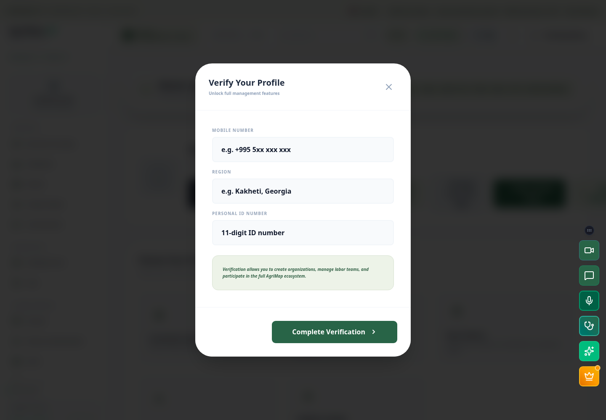

*Legacy verification screen. Follow your platform administrator's approved verification process; do not interpret the screen's older “unlock” wording as permission to self-grant access.*

### Register services or request agro-agent onboarding

For an individual service provider, use the personal service profile: specify service, skills, operating regions and availability. Companies can then discover your opted-in profile and agree terms directly.

The legacy **Become Agro-Agent** entry currently requires verification and does not provide proven self-service accreditation. Request onboarding from an authorized platform/company administrator. A company can organize approved people under **Individual Tools → Human Resources → Teams & Units**. An agro-agent description on a public profile does not grant access to another person's payroll or company operations.

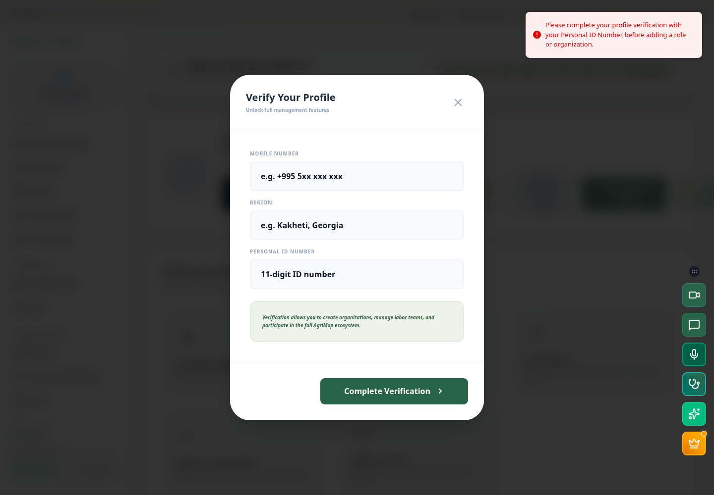

*Current agro-agent entry redirects to verification; no accreditation was submitted.*

**Check:** confirm the approved organization, team scope and permissions with an administrator. Keep worker consent and an explicit account-to-employee link. Do not create duplicate identities to bypass a verification block.

## 4. Roles and navigation

| Account | Main workspace | Important boundary |
| --- | --- | --- |
| Individual / worker | Dashboard, My work & earnings, AI Agro Analyst, Communicator, profile | No direct company Harvest, Accounts, Stock, Agronomy or Tasks/Works access |
| Newly registered individual without an active company membership | Personal workspace and draft Map Planner | May draw a draft; cannot save company plantation data before company registration |
| Company Admin, Manager, Founder or Co-Founder | Authorized operational modules | Must belong to the active company; role does not authorize other companies |
| Verified platform administrator / root | Platform administration according to verified authority | Not a public signup option |
| Local owner | Local management workspace | Local worker provisioning does not create cloud roles |

Older per-module HR checkboxes do not elevate an ordinary account into management. A worker receives assignments and harvest notifications on their dashboard and sees their own work/pay records. Management sees the operational screens used throughout this guide.

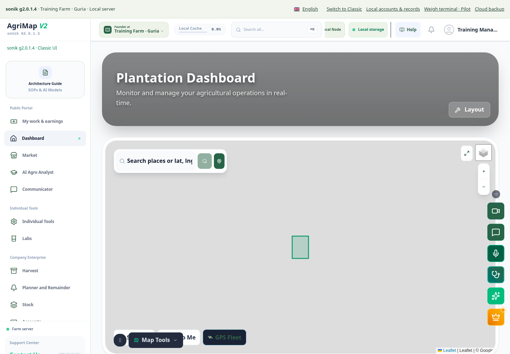

**If a module is missing:** check active company, membership status and current signed-in account. Ask the company administrator to verify the membership. Refresh after an approved change; do not change local browser role values.

## 5. Register Company & Varieties

**Who:** an eligible company creator or authorized management user.

1. Open **Dashboard → Map Tools → Company Registration** (or the company registration action in your profile).
2. Enter legal/display name, country, region and the requested registration/contact details.
3. Confirm the company location and area carefully. Submit **Register Organization** once.
4. Select the newly created company and confirm your management membership.
5. Open **Crops Management** from **Dashboard → Map Tools** (also available in Map Planner tools). Register the crop first, then varieties; use consistent spelling.
6. Assign the correct crop and variety to each sector/row so harvest and agronomy reports can be grouped reliably.

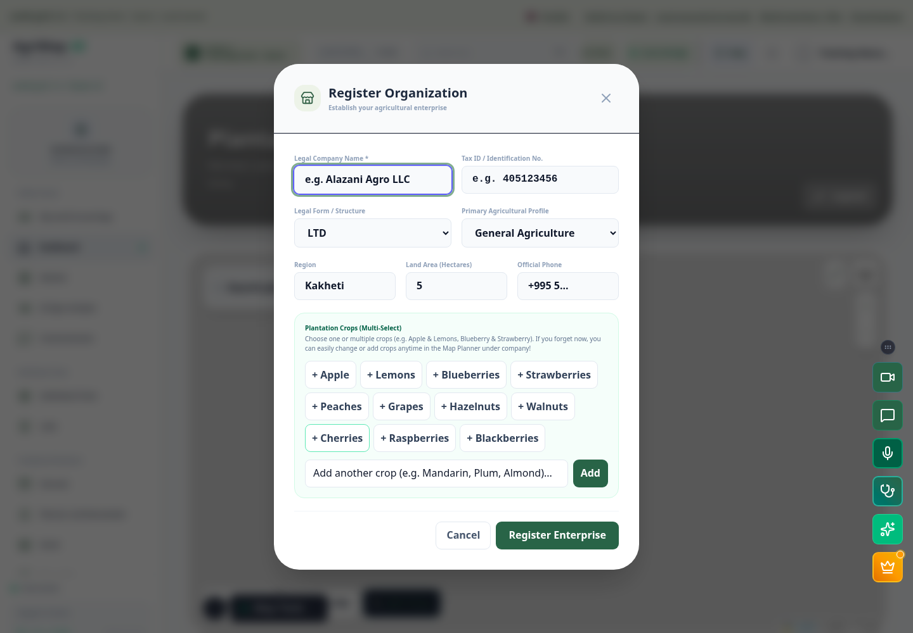

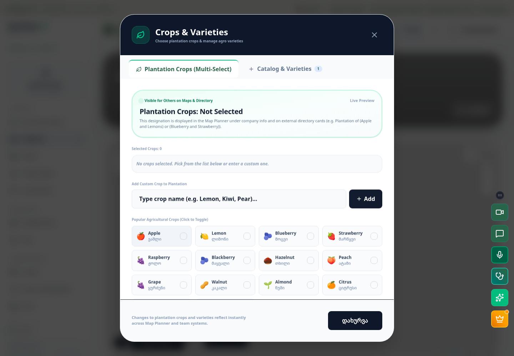

**Local difference:** company registration configures the existing farm workspace. It does not create multiple independent local farm tenants. If you see “This server has one farm workspace,” return to the current farm and configure it instead of creating a second one.

**Check:** reopen the active company and sector. Confirm region, units, area, crop and variety before inviting staff. Do not create two companies to fix a display-name problem.

## 6. Map Planner & Boundaries

**Before starting:** know the correct plantation location and whether you are editing a company map or an unsaved personal draft.

1. Open **Map Planner** and locate the plantation with search or map navigation.
2. Select/create the appropriate layer. Keep boundaries, sectors and rows organized in clear named layers.
3. Choose the boundary/polygon tool; place the corners and close the polygon. Zoom in to inspect the edges.
4. Draw sectors inside the boundary, then rows/trenches and planting features where needed.
5. Give each feature a clear name and assign crop/variety and other required attributes.
6. Save only under the correct company. Reload and confirm geometry and labels remain.

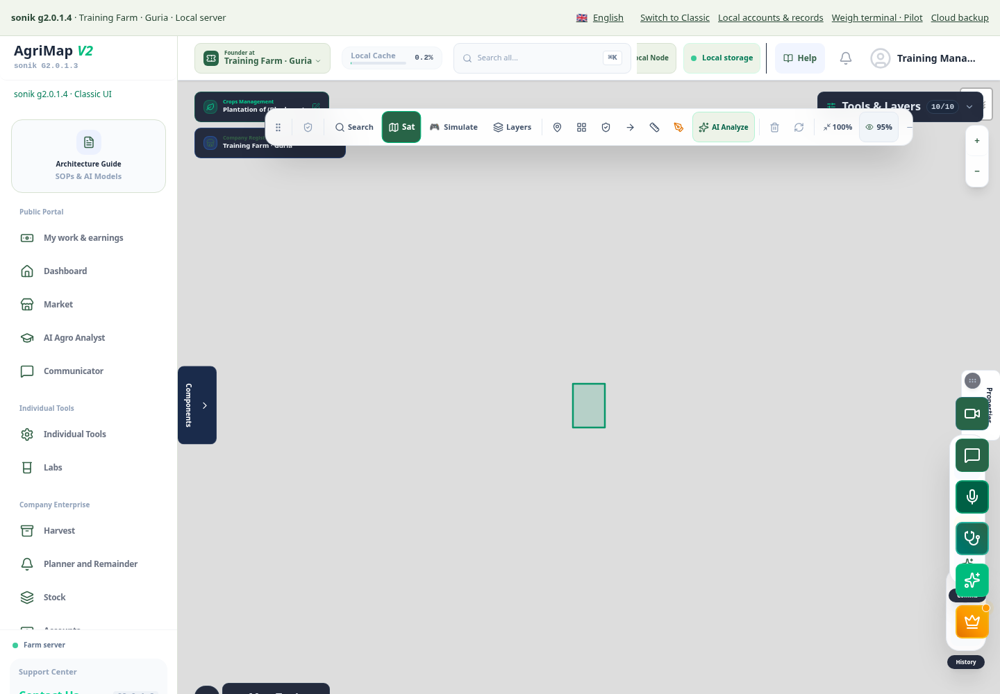

*Training geometry only. The capture has external basemap tiles disabled; use the configured provider in the live application. This is not a surveyed boundary.*

**Check:** latitude/longitude order, units and overlaps. A drawn polygon is a management aid, not a cadastral ownership record. A personal draft is memory-only: do not close it expecting a saved company map.

## 7. Register Workers & Teams

1. Open **Individual Tools → Human Resources**.
2. Create one employee per real person. Enter identifying contact details, employment type and the agreed payment model/rate.
3. Where available, link the signed-in user/account to the employee ID. This link makes the person's own earnings visible.
4. Open **Teams & Units** and create a named team. Add the correct employee records and designate coordination responsibilities.
5. Review **Daily Attendance** for the correct day and record actual attendance/hours.
6. For cloud joining, invite/request membership using the supported company flow and have management approve it. Accepting an invitation is not a substitute for confirming the persisted membership and employee link.

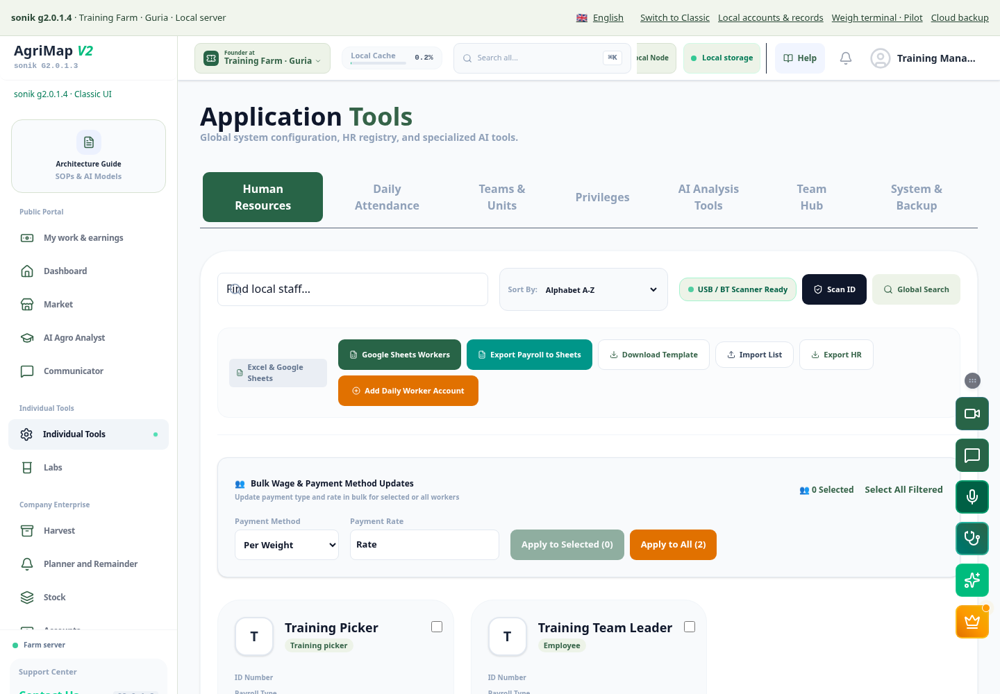

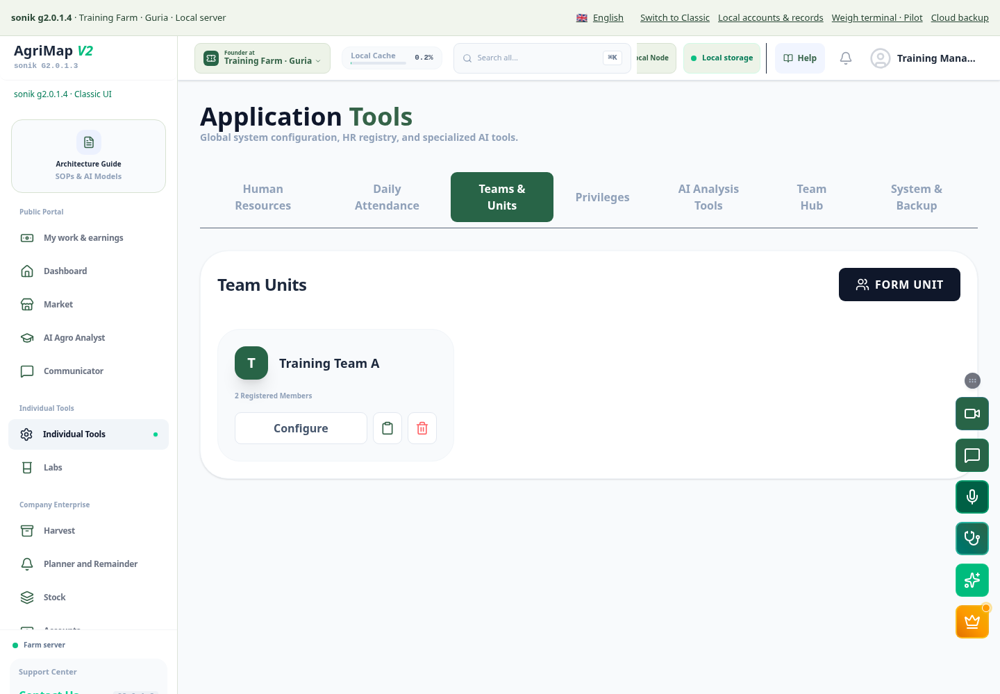

**Check:** confirm agreed currency and rate basis: per kilogram, hourly, daily, salary or combined. Never treat a rate as a payment. Use a test worker login to confirm access and personal history without granting management rights.

## 8. Manage Stock & Inventory

1. Open **Stock → Main Stock & Depots**.
2. Choose the warehouse/depot. Add an item with a clear name, category, unit, quantity and cost.
3. For packaging, record the correct tare and units where supported; distinguish a crate from a kilogram of produce.
4. Use receipt/intake for deliveries, transfer for movement between depots and charge/issue for actual use.
5. Record the source reference and responsible person. Review the inventory history before correcting a balance.
6. Reload the catalog and verify the item and movement in the intended depot.

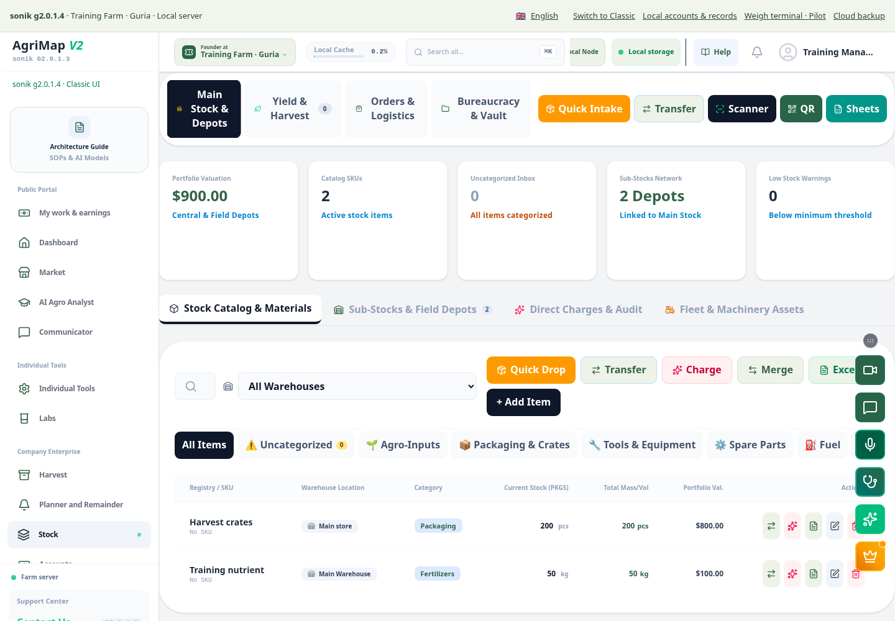

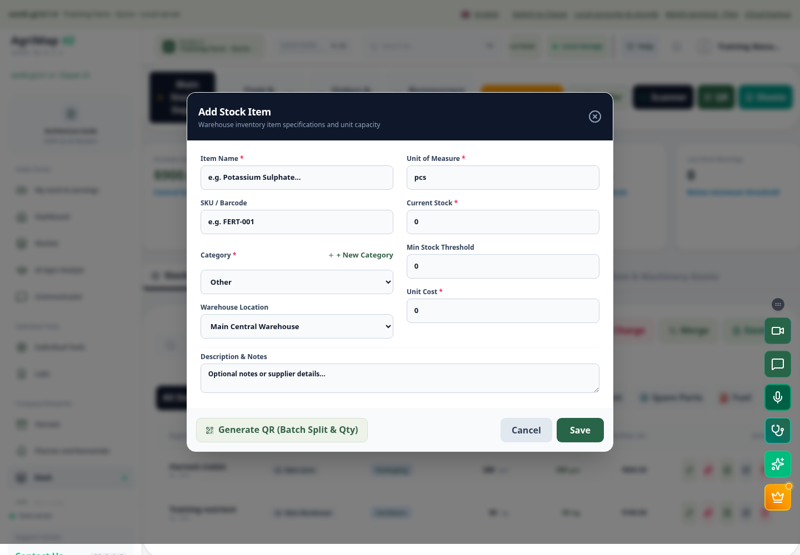

**Check:** do not add a delivery manually and then receive the same purchase order again. Transfers move stock; they are not purchases. An application/treatment plan is not evidence that materials were actually used.

## 9. Purchase Orders & Materials

1. Open **Stock → Orders & Logistics**.
2. Create a purchase order. Select supplier, destination depot and required items.
3. Verify quantities, units, prices, currency and expected delivery date. Save the order.
4. When goods arrive, compare the physical delivery with the order and invoice.
5. Receive only the delivered quantity through the supported receipt action; record shortages or discrepancies.
6. Confirm the resulting stock movement before booking payment separately.

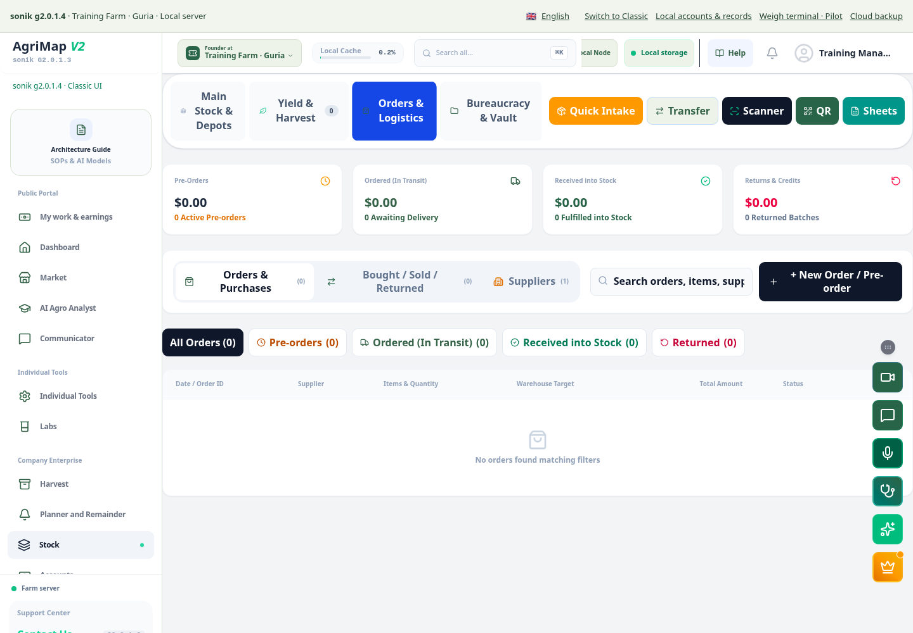

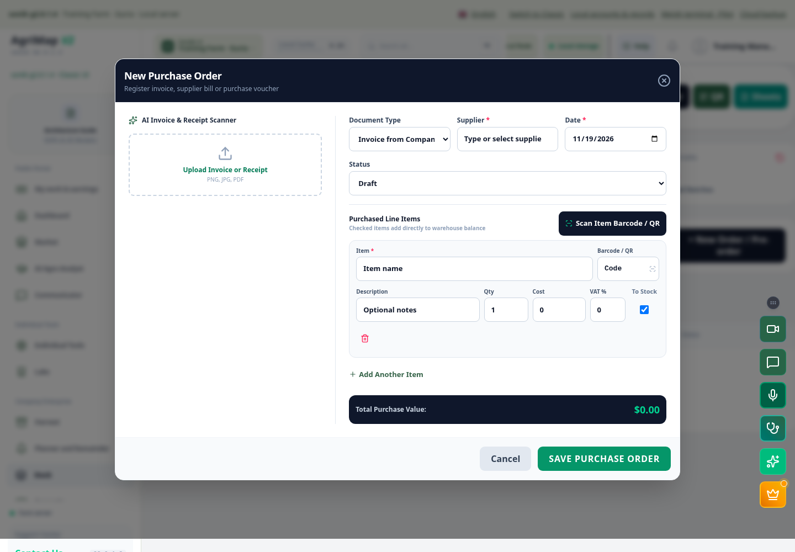

**AI document assistance:** extracted invoice data is a draft. Verify supplier, quantities, tax and totals against the original before accepting it. A purchase order, goods receipt and supplier payment are different events; do not assume every screen automatically posts all three.

## 10. Start Harvest Session

**Before starting:** company/sector/variety, workers, rates and packaging must be correct. If the event form says **No areas defined**, create and save the plantation’s area/sector features first, then reopen the form.

1. Open **Harvest → Start New Session**.
2. Name the event and select the date, targeted sector(s) and variety.
3. Choose the protocol that matches your actual workflow. Confirm scanner/scale compatibility before using it for live pay calculations.
4. Assign pickers and their payment models/rates. Add vehicles/materials where relevant.
5. Verify tare, units and whether quantities are boxes or kilograms. Save/start the event.
6. Open the event card and check the live dashboard before the first real entry.

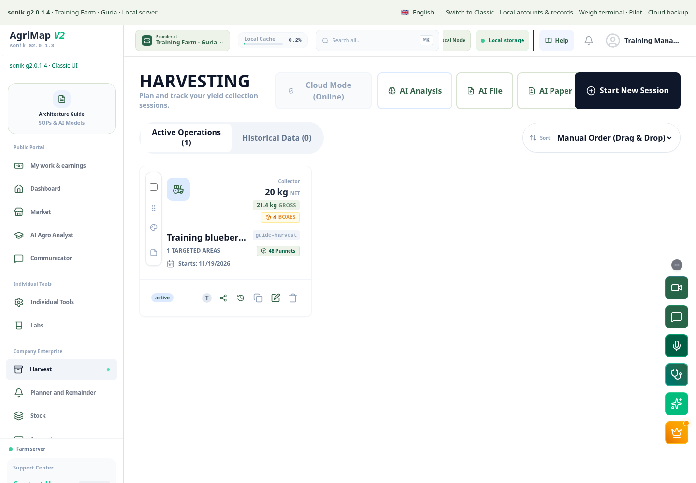

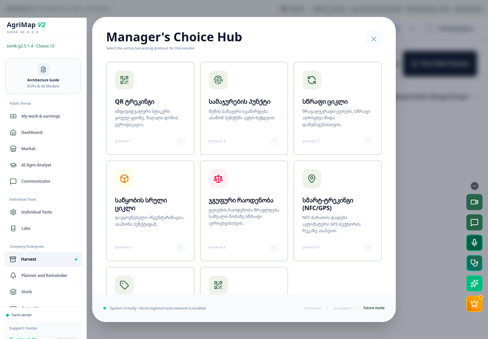

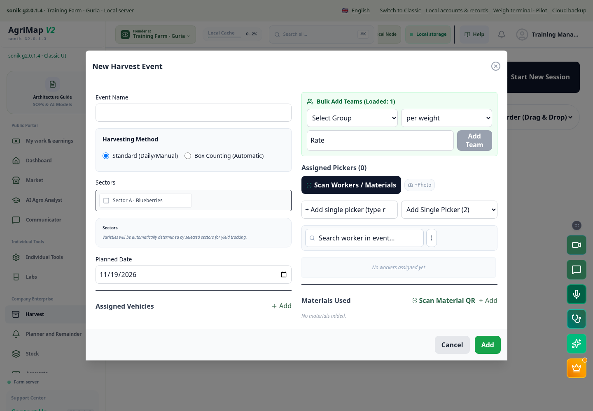

*Some protocol names/descriptions remain Georgian even with English selected. This guide explains the workflow in English; these legacy strings were not changed in this documentation update.*

The UI offers QR, bracelet, rapid-cycle, stock-oriented, bulk, smart/RFID and other protocols. Availability of a named protocol does not prove a particular physical device works. Passive NFC cards do not provide GPS by themselves; location requires a separate location-capable device/integration.

**Check:** one real event has one agreed operating protocol and worker rate basis. Avoid running two events for the same picking session accidentally.

## 11. Live Monitoring

1. Open **Harvest** and select the active event card.
2. Review event status, assigned workers, net/gross weight, box count and material/labor totals.
3. Filter by worker, sector or variety where offered. Inspect individual records when a total looks wrong.
4. Compare a recently accepted entry on the weighing device with the management view.
5. Pause the session for a genuine interruption; resume before further work. Ensure operators know the status.

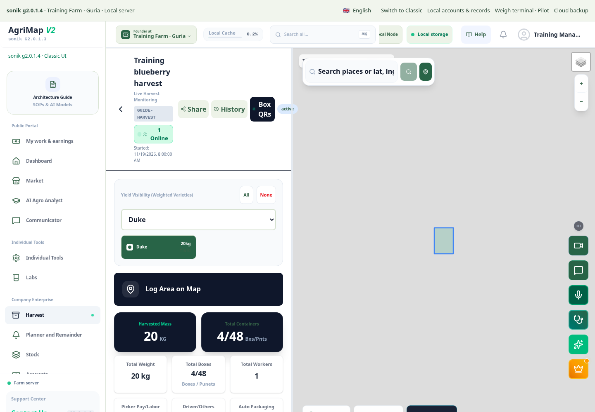

**Check:** “live” depends on connection and confirmed server data. A disconnected tablet is not proof that a second user's entries are missing. Wait for synchronization and review record-level history before entering the same quantity again.

## 12. Weigh Station

### Operational weighing inside Harvest

1. Open the correct active event and select its **Weigh / Add Entry** action (label depends on protocol).
2. Confirm the picker, crate/QR identity, sector and variety.
3. Read a stable gross weight, confirm tare and inspect the calculated net weight: **net = gross − tare**.
4. Save once. Wait for acceptance and verify the new record and total before weighing the next crate.
5. If an entry looks duplicated, stop and compare the original worker, QR, weight and time. Correct the existing record through authorized controls rather than blindly adding another.

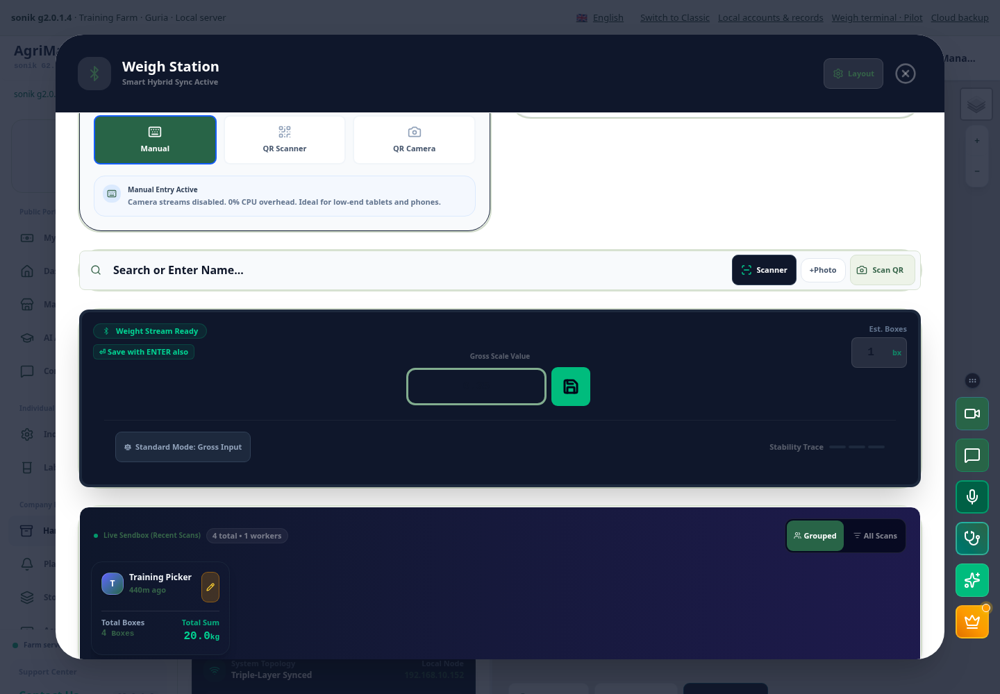

**Hardware:** grant camera/Bluetooth/USB permissions only for the intended device. Browser support and secure-context requirements differ. A USB keyboard-wedge scanner can type a code into a focused input; this does not prove Bluetooth scale, camera or Zebra support on every tablet. Keep a tested manual-entry fallback.

### Separate Weigh Terminal — Pilot

The top **Weigh terminal · Pilot** opens a separate owner-only terminal. It supports manual/keyboard-wedge QR entry, manual gross/tare, its own IndexedDB queue, idempotent submission and suspicious-duplicate review with timestamps/reasons.

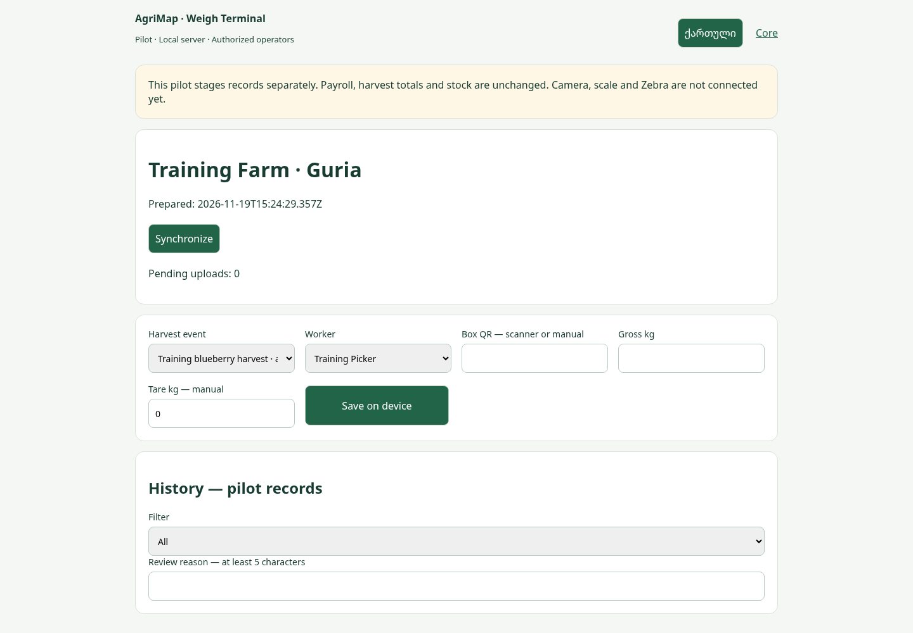

**This pilot stores staging records only. It does not post into operational harvest, payroll or inventory.** Do not enter a real session in both paths expecting automatic reconciliation. Device integrations and full production posting require additional validation.

For a suspected duplicate, review the flagged record, original scan, capture time, server receipt time and responsible user/device. Document a reason for an authorized override. Treat red/suspicious entries as unresolved until reconciled, not extra payable produce.

## 13. Finalize: Storage, Market, or Sell

1. Stop new entries and ask all operators whether any work is unsynchronized.
2. Reconcile workers, individual weights, crate count, tare, materials and unresolved duplicates.
3. In the event dashboard choose **Finish Job / Finalize**.
4. Choose the physical destination: storage, market/listing or sale as offered by the selected workflow.
5. Enter destination depot or buyer, quantity, unit price and other required details. Save once.
6. Confirm event status and the resulting produce/stock records. Record actual received payment separately.

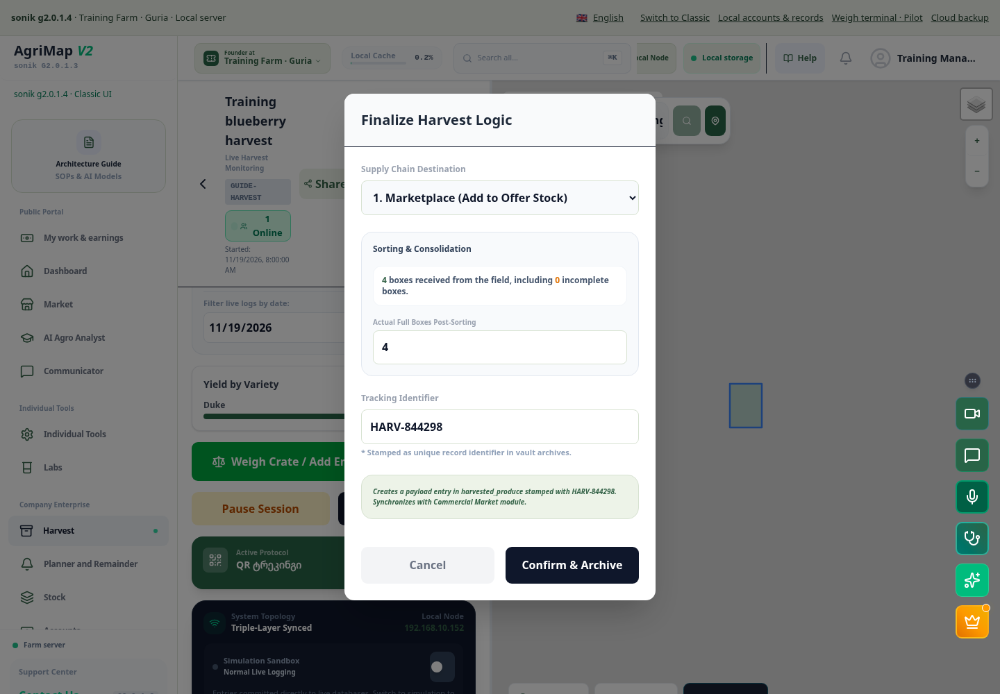

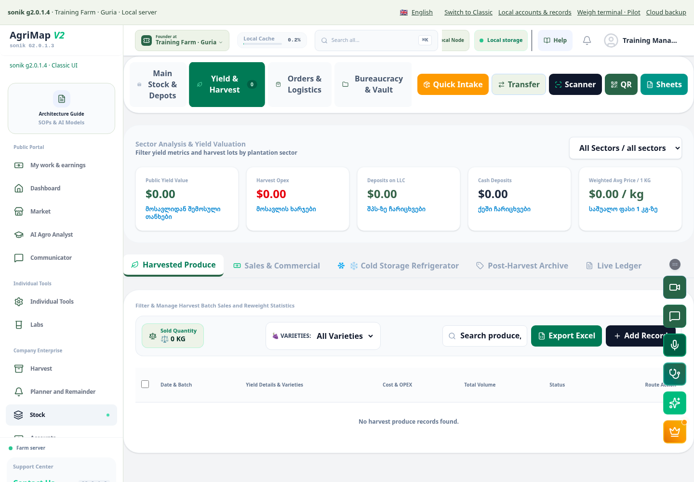

**Check:** a market listing is not a completed sale; an invoice is not cash received. Reconcile quantities before finalization and verify resulting stock rather than assuming every destination has an identical posting path.

## 14. Tasks, Works and Scheduler

### Tasks and Works

1. Open **Tasks and Works** to define or review the work to be performed.
2. Select sector, date, employees/team, work type and agreed pay basis.
3. Save the assignment and confirm that the intended workers can see their published assignment/notification.
4. Record actual hours/quantities when work is completed. Review corrections before payroll.

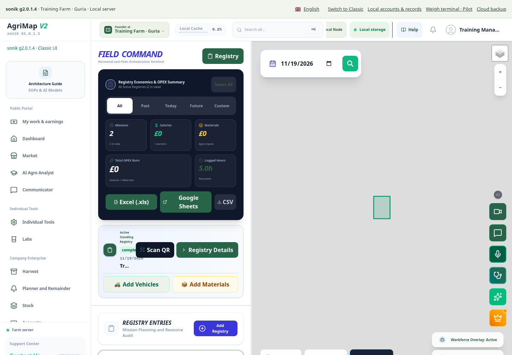

### Planner and Remainder

1. Open **Planner and Remainder** (the current menu label).
2. Select date/calendar view and create the scheduled item or reminder.
3. Include clear instructions, location, responsible person and due date.
4. Update status after the work is performed; a calendar appointment is not proof of execution or payment.

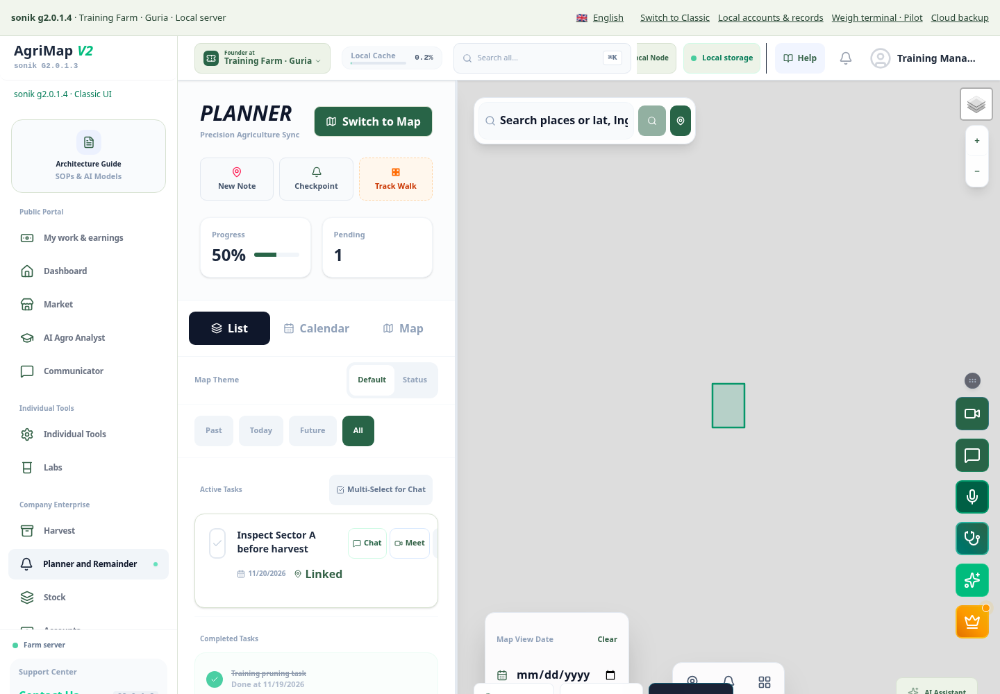

**Field sprayers:** schedule inspection/application only after confirming product, dose, area, actual weather and agronomist approval. Scheduler and device panels are planning/configuration interfaces unless a tested control integration is installed. They do not establish autonomous safe spraying or automatic material deduction.

## 15. Agronomy Module

1. Open **Agronomy** and select the relevant plan/recipe workflow.
2. Specify purpose, target sector, timing and materials/quantities using correct units.
3. Review availability and the agronomic suitability of the proposal. Save the plan.
4. Schedule or register execution through the relevant work/execution controls.
5. Record what was actually applied, by whom and when; compare actual material use with inventory history.
6. Retain notes and references for later review. Reusing a plan requires a fresh check of crop, stage, location and weather.

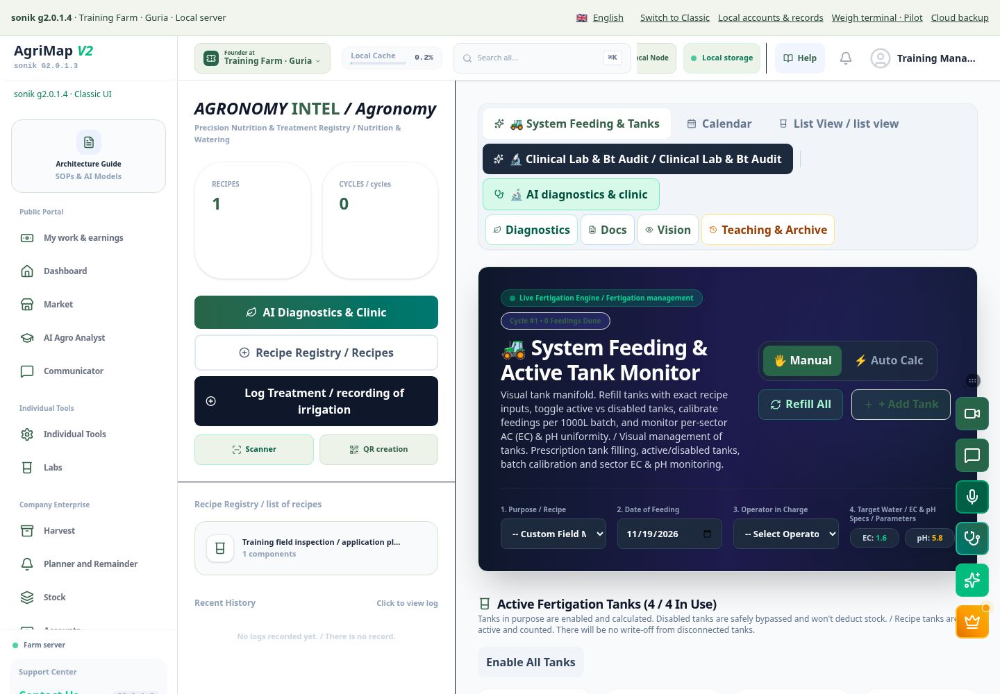

*The module also contains legacy demonstration tank/mix controls. Do not treat their prefilled ingredients or quantities as your actual installation; configure and verify your own records before logging a real application.*

**Check:** saving a prescription/plan is not completing an application. The “Training nutrient” in screenshots is fictional and is not a dose or treatment recommendation.

## 16. Agro AI Analyst & Prescription Coordinator

1. Open **AI Agro Analyst**. Choose the relevant question, document or diagnostic tool.
2. Provide crop/variety, location/sector, date, symptoms and clear photos or supported documents.
3. Ask a specific question and review the response against your observations. Distinguish missing configuration/provider errors from a genuine analysis.
4. Open **Diagnostics & Clinical Tools** for the prescription workflow.
5. Set **Severity Level** and **Target Sector**. Use **AI-Generated Plan**, **Create Plan** or combined editing as appropriate.
6. Add your conclusion/comment. Review all material quantities and assumptions.
7. **Save** to the archive, or use **Save and add to Agronomy** when authorized and ready to create an execution plan.
8. Open an archived item to read full content, edit, reuse or delete according to permissions. Check the source category and date.

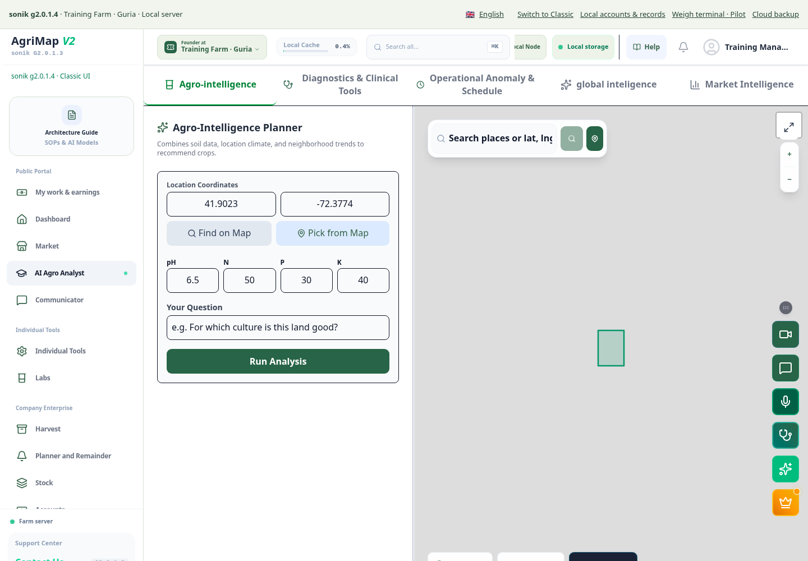

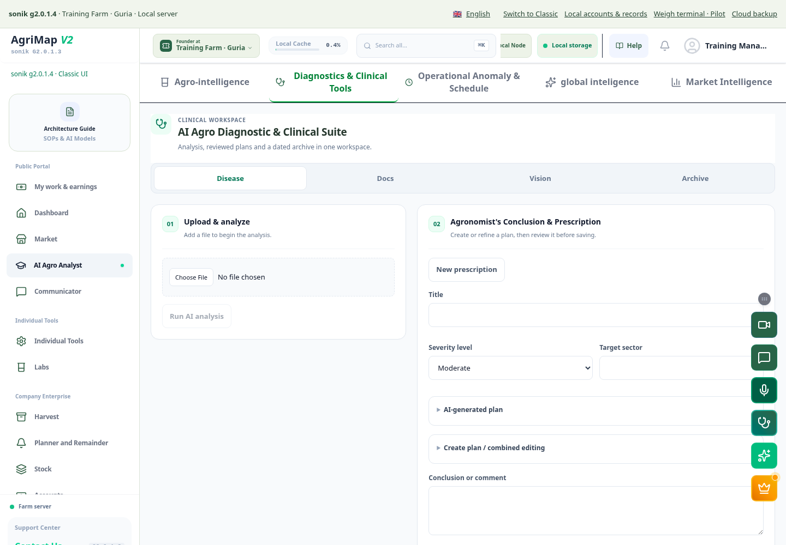

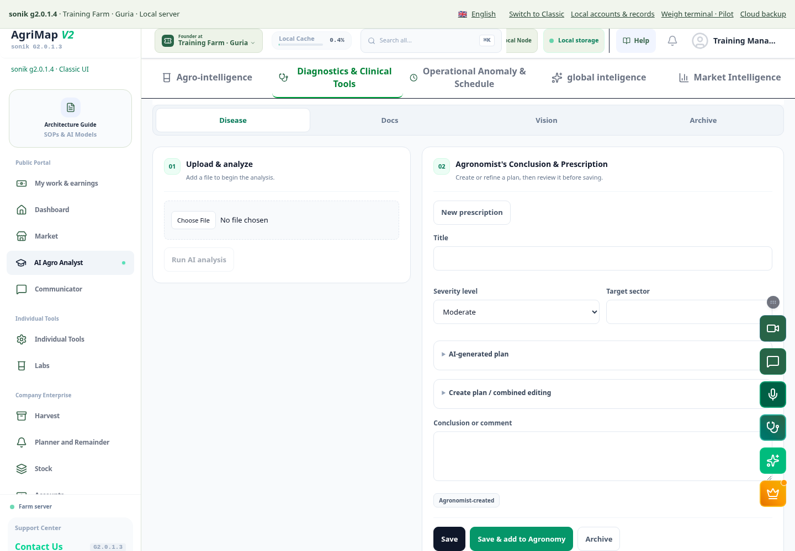

Archive categories distinguish **AI-generated**, **Agronomist-created** and **Combined**. Saving to Agronomy creates a plan; it does not automatically execute treatment or consume stock.

**Gemini:** “copilot” describes the assistant's role, not necessarily a different provider. This version uses a server-side Gemini gateway for supported AI requests. A server provider key/authentication must be configured. No live provider was connected for these screenshots, and no disease-accuracy percentage is claimed. If every prompt returns a fixed response, report the exact tool, mode and error to the administrator; do not rely on it as a diagnosis.

## 17. IoT Station, Soil Monitors & Weather

1. Open **Labs / Hardware & Devices** and the relevant weather or sensor tool.
2. Register the intended device and assign its location/sector. Record model, identifier and expected units.
3. Configure the approved gateway/backend integration. Keep credentials in server configuration, not public notes or map labels.
4. Confirm a real measurement reaches the correct company and location, with a timestamp and unit.
5. Test disconnection and stale-data handling before enabling operational alerts.
6. Compare forecasts separately from local observations; verify alert thresholds and delivery with a controlled test.

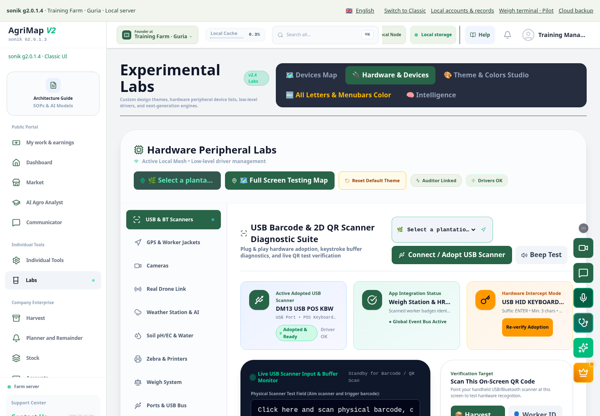

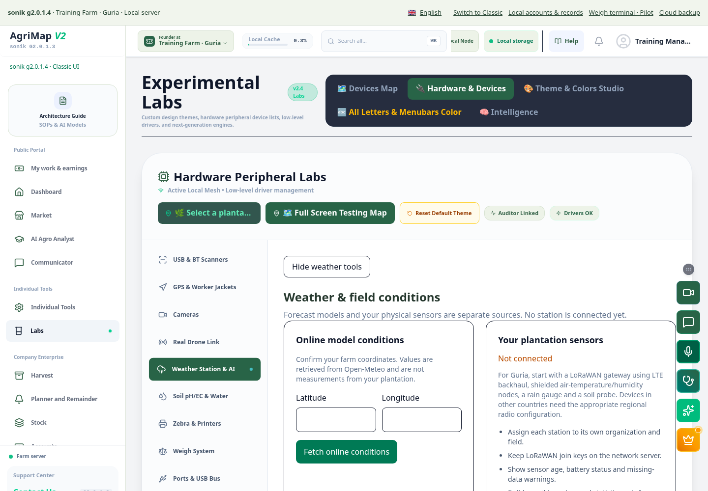

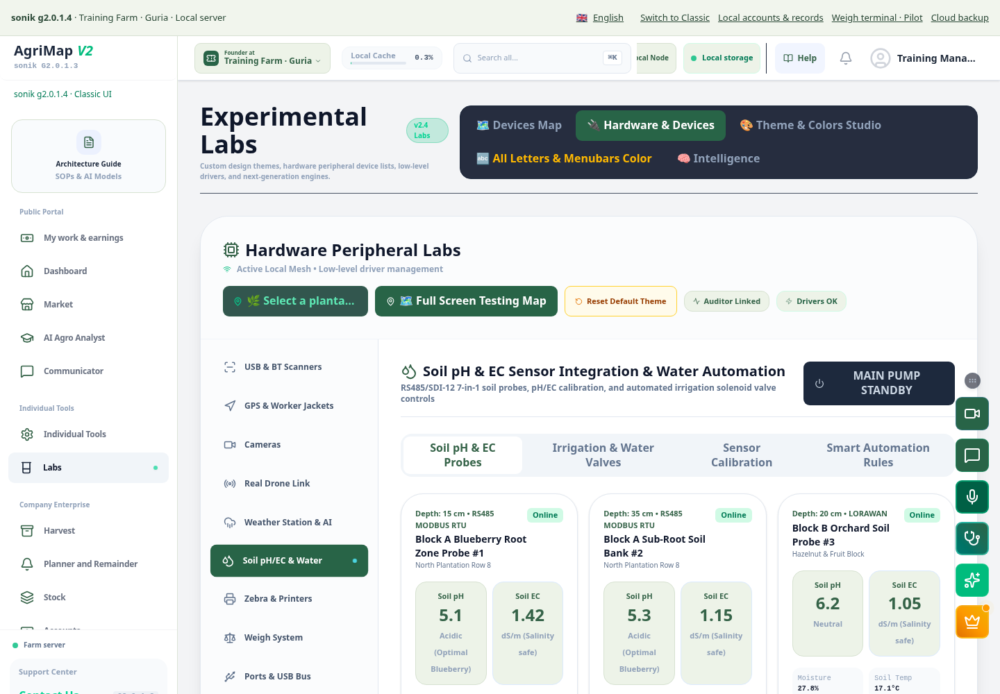

*The displayed probe values and “Online” badges are demonstration UI, not readings from connected field instruments.*

The current weather/hardware screens include planning/configuration and demonstration elements. This guide does not certify live sensor ingestion, autonomous irrigation or universal device compatibility. Missing readings are not zero; old readings are not current conditions.

For Guria, a typical design is **LoRaWAN sensors → gateway → LTE/Ethernet → network server → authenticated application ingestion**. Choose the regional radio plan and survey coverage before purchasing multiple nodes. A D20S-LB is a temperature sensor, not a complete humidity/rainfall station. Add appropriate humidity, rainfall and soil sensors as needed. LoRaWAN carries small measurements; cameras require a separate video connection. An always-on local gateway is needed for local acquisition even if the user works only on a tablet.

## 18. Double-Entry Ledger Logs

1. Open **Accounts** and review the company/currency and reporting period.
2. Open ledger/log entries and inspect a source transaction.
3. For a new entry, choose the correct debit and credit accounts, date, amount, currency and description/reference.
4. Confirm the business event: expense accrual, payment, sale, receipt or transfer.
5. Save once and verify both sides and the source reference. Review the employee/payroll link where applicable.
6. Correct mistakes with an authorized traceable correction/reversal, preserving the explanation.

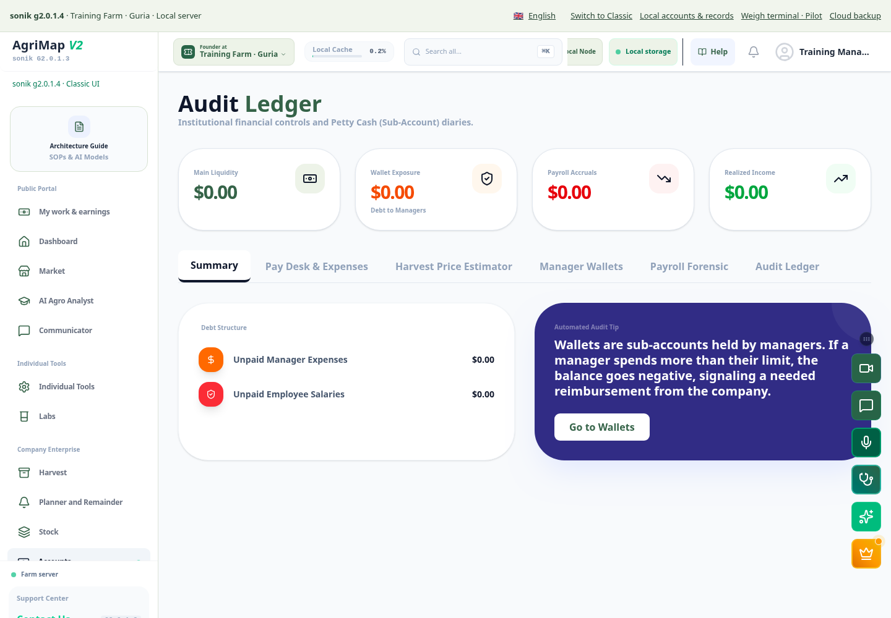

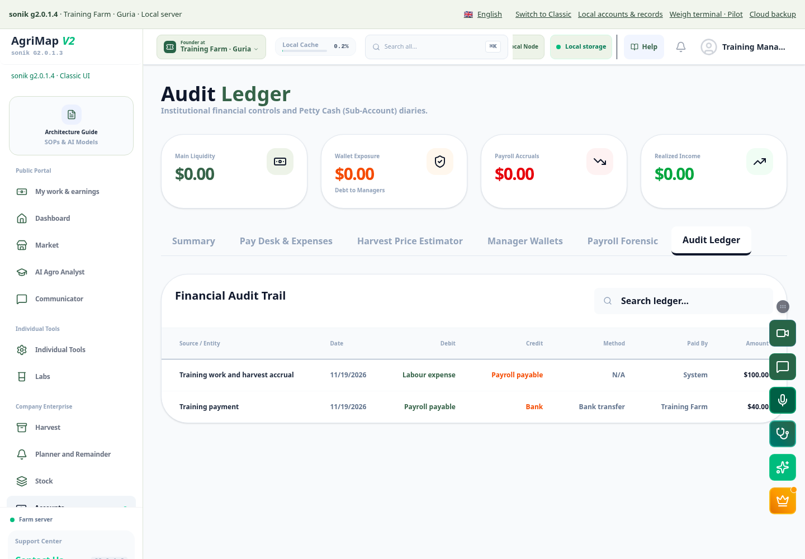

*This legacy ledger formats amounts with the selected display symbol. It is not evidence of currency conversion: the training transactions retain GEL, as shown in the worker payroll view. Confirm source currency before financial decisions.*

**Example, not accounting advice:** recording a worker's earned amount creates a payable; paying them reduces that payable and cash/bank. Do not record the same expense again as a second accrual when entering the payment. Never net different currencies together without an explicit exchange transaction and rate.

## 19. Communicator: Announcements, Partners & Forum

### Find plantations and work

1. Open **Communicator → Announcements & Plantations**.
2. Filter by region and the available company/crop/variety criteria.
3. Switch between list and map as offered. Open a company marker/card for details: plantation, varieties, area and published vacancies.
4. Review job type, location, dates and compensation, then contact the company using the offered partner/contact action.
5. Confirm employment terms directly before starting work. A listing is not a confirmed contract.

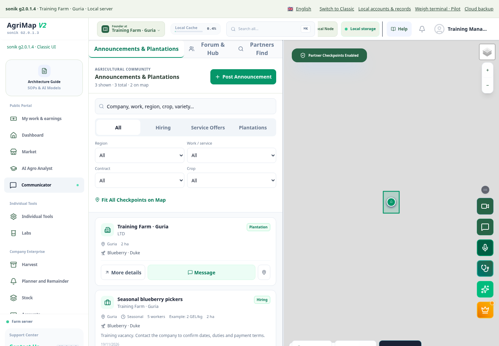

### Publish a company vacancy

1. An authorized company user selects **Post Announcement**.
2. Enter title, work type, region, employment type, required number of people, compensation and a clear description.
3. Publish and verify it in the filtered list. Update or close outdated vacancies.
4. Publish only approved business details; do not put worker identity or payroll information in the announcement.

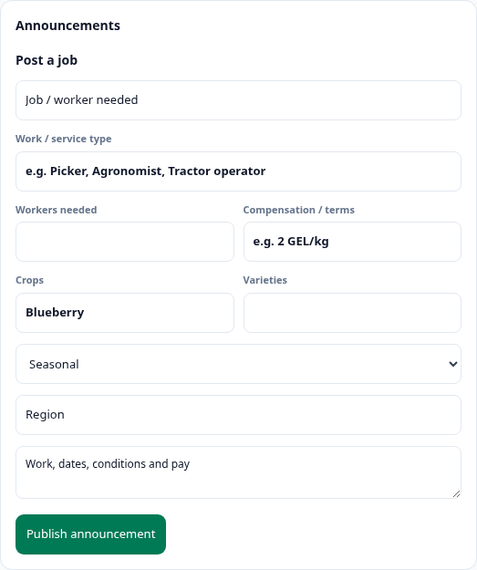

*Form detail captured in a tall browser viewport. In shorter windows the current composer can collapse into a narrow scrolling strip; enlarge the window or reduce browser zoom to inspect the fields. This is a known UI limitation, not a missing permission. The form may need internal scrolling.*

### Forum and partner communication

Management can open **Forum & Hub**, choose the appropriate channel/audience and post a clear topic or reply. Ordinary workers use the permitted discovery/partner communication features; they do not gain the full company forum or administration workspace. Use toolbar Google/chat tools only where separately authorized; they are not a prerequisite for Communicator discovery.

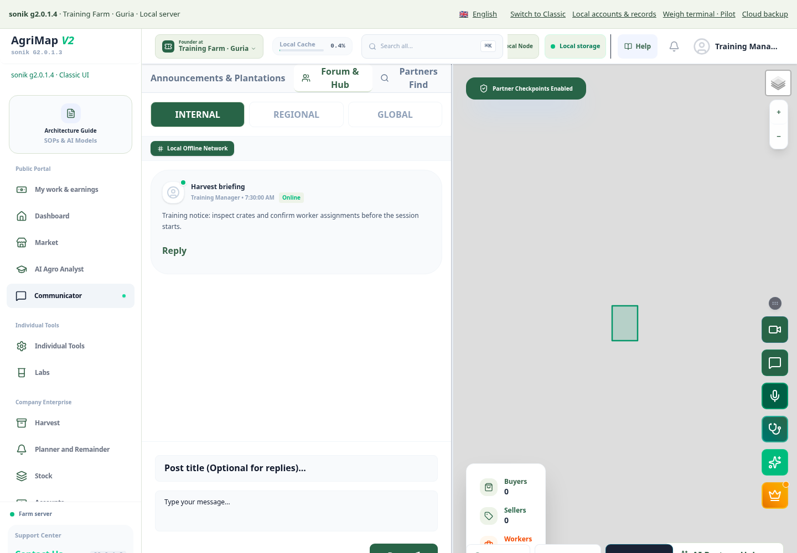

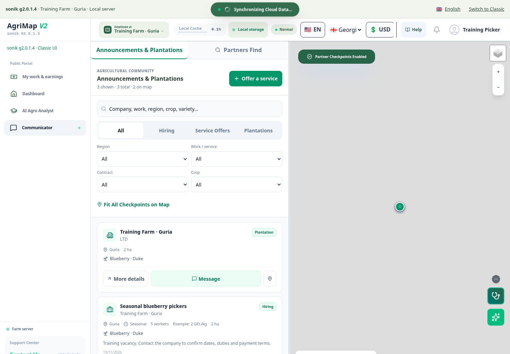

**Check:** choose the intended public/company/private audience before posting and confirm the visible result after publishing.

## 20. My Work & Earnings, CV, Services & Reviews

1. Open **My work & earnings**.
2. Review your summary totals, currency and unpaid/paid balances.
3. Open each work/harvest record to inspect date, employer, hours/quantity, rate and calculation.
4. Compare payment history with actual payments received: payer, time, method, amount and reference where recorded.
5. Expand **My CV, services & reviews** to maintain your experience and offered services.
6. Use **Find partner & work** / Communicator discovery to find companies and vacancies.
7. If a record is missing, ask management to check the explicit account-to-employee link and the saved source records. Do not create a second account to recover history.

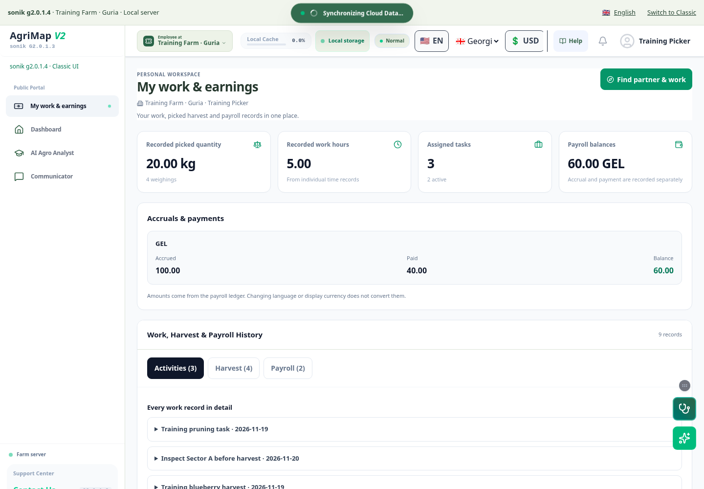

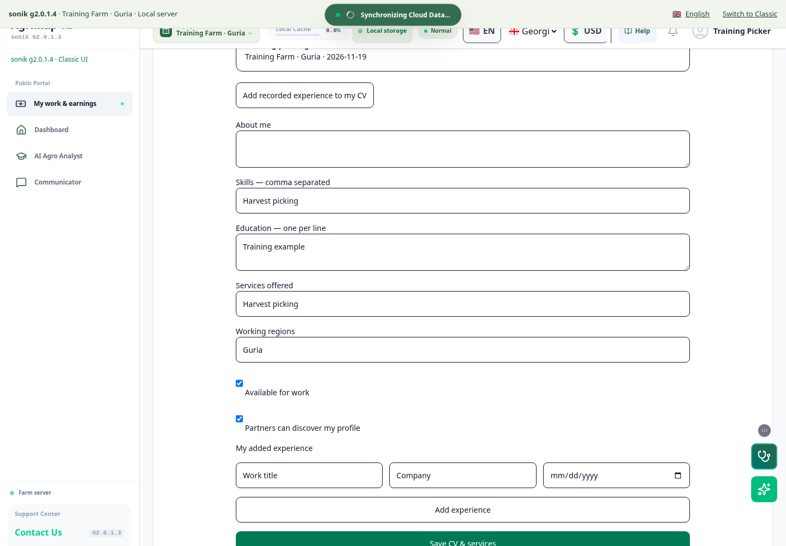

*Fictional training example: 20 kg picked and 5 hours worked; recorded accrual 100 GEL, payment 40 GEL, remaining balance 60 GEL. These are seeded demonstration records, not a live payment or a certification of automatic posting.*

Workers see their own data, not everyone's payroll. A calculated earning does not mean it has been paid. Dispute a specific record with its date/event/reference so management can investigate without destroying the audit trail.

## 21. Tablet and Mobile Use

1. Use the approved server URL and a supported up-to-date browser.
2. Confirm the connection and intended account at shift start.
3. Use the mobile menu where the sidebar is collapsed; scroll within the active panel/modal to reach its actions.
4. Keep camera and hardware permissions limited to the tested workflow. Close unnecessary camera/video panels when not in use.
5. Before leaving coverage, test the exact offline workflow and which records are already cached. Keep the tablet charged and do not clear browser data while work is queued.

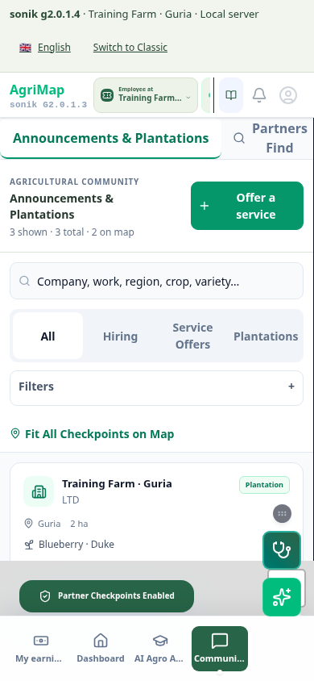

## 22. Offline Work, Concurrent Users and Recovery

A complete universal offline merge is not implemented for every module. The rich LAN application requires confirmed server writes; the separate terminal pilot has its own offline outbox and **staging-only** sync. Cloud caching supports a subset of previously loaded data and does not guarantee every action is available without internet.

When two operators work on the same event:

1. Agree event, assigned devices and entry responsibilities before starting.
2. Give each physical transaction a unique record identity; distinguish a transport retry from a genuinely new crate/entry.
3. On reconnection, let queued submissions settle; do not re-enter everything manually.
4. Compare individual records, capture times, server receipt times and user/device information where available.
5. Resolve duplicate/suspect records explicitly before payroll or closing. Avoid restoring a whole stale snapshot over a colleague's newer work.

If uncertain, pause finalization and retain device data until management reconciles it. The terminal pilot's idempotency protects its own submissions; it does not guarantee global deduplication across unrelated offline devices or automatically reconcile staging into operational harvest.

### Training screenshot index

The [capture manifest](screenshots/manifest.json) lists every screenshot, viewport, application route and source commit. Captures show screen availability and training data, not certification of every save, provider or hardware path.

### Quick troubleshooting

| Symptom | First checks | Recovery |
| --- | --- | --- |
| Registration/company error | Cloud vs local URL, existing farm, signed-in account | Configure existing local farm or use the correct cloud registration flow |
| Missing operational modules | Membership role, active company, approval | Administrator verifies persisted membership; ordinary workers intentionally have personal tools only |
| No earnings | Employee/account link, source entries, transaction currency | Management checks records and explicit IDs; avoid duplicate users |
| Scan repeats | Same crate/code, capture times, original record | Stop, inspect, document authorized correction/override |
| AI repeats/fails | Tool, provider configuration, server error | Administrator checks Gemini gateway; retain input for review |
| Weather blank/stale | Sensor timestamp, gateway, units, connection | Treat as unavailable; verify acquisition before relying on alerts |
| Local page unavailable | Server process, startup URL, LAN address, HTTPS | Restart existing server; do not rerun farm initialization |
| Old UI after update | Correct Git checkout/build and cached PWA | Rebuild/restart, then reload; preserve unsynced data before changing caches |

## 23. Glossary and Documentation Sources

- **Company / organization:** the data and access boundary for a farm workspace.
- **Account / user:** login identity. **Employee:** company HR record; explicitly link it to the account.
- **Gross / tare / net:** loaded weight / packaging weight / produce weight.
- **Accrual / payment:** money recorded as earned / money recorded as transferred.
- **Order / receipt / issue:** request to buy / goods physically received / materials consumed or issued.
- **Plan / execution:** intended work / recorded actual work.
- **Forecast / observation:** predicted weather / measured conditions at a known time/location.
- **Duplicate / retry:** a repeated business entry / another delivery attempt for the same record.

The guide was checked against current screens and these repository documents. Historical plans describe intentions and are not evidence that an integration is operational:

- [User access policy](../../USER_ACCESS.md)
- [Registration and data authority](../../UI_MODERNIZATION/REGISTRATION_AND_DATA_AUTHORITY.md)
- [Local server operations](../LOCAL_SERVER.md)
- [Weigh terminal pilot boundaries](../../HARDWARE_MODULARIZATION/WEIGH_TERMINAL.md)
- [Guria pilot](../GURIA_PILOT.md)
- [Weather and camera integration planning](../WEATHER_AND_CAMERAS.md)
- [Code file guide](../../CODE_FILE_GUIDE.md)
- [Update history](../../UPDATE_HISTORY.md)

**Maintenance:** update this guide when a workflow changes, record the date/source commit, recapture the affected screenshots and rebuild HTML/PDF. Screenshot reproduction uses an isolated temporary farm through `scripts/capture-user-guide.mjs`; it does not connect to production accounts or devices.
