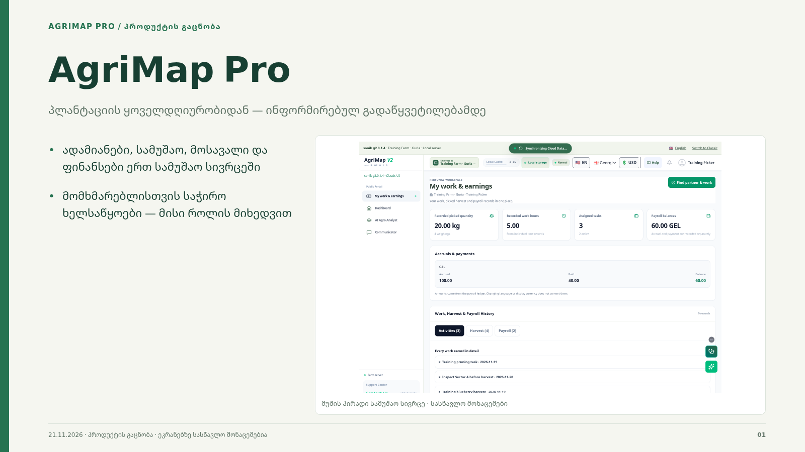

# AgriMap Pro — ქართული პროდუქტის პრეზენტაცია

**21 ნოემბერი 2026 · 16 სლაიდი · დაახლოებით 15 წუთი**

- [PowerPoint — რედაქტირებადი პრეზენტაცია](AgriMap-Pro-Product-Introduction-ka.pptx)
- [PDF — გასაზიარებელი ვერსია](AgriMap-Pro-Product-Introduction-ka.pdf)
- [ბრაუზერის ვერსია](index.html)
- [მომხსენებლის ქართული ჩანაწერები](SPEAKER-NOTES-ka.md)
- [სლაიდების რედაქტირებადი ტექსტი და სტრუქტურა](deck-ka.json)
- [ეკრანის სურათების წყაროები](screenshot-sources.json)

პრეზენტაცია განკუთვნილია პროდუქტის ახალი მომხმარებლებისა და საპილოტე პარტნიორების გასაცნობად. სიუჟეტი იწყება პრაქტიკული საჭიროებებით, გადის პლანტაციის, გუნდის, კრეფის, აწონვის, მარაგების, ფინანსებისა და აგრონომიის პროცესებზე და სრულდება დანერგვის საცდელი სამუშაო დღით.

ეკრანის სურათებში გამოყენებულია გამოგონილი სასწავლო მონაცემები. ეკრანების უმეტესობის წარწერები ინგლისურია; სლაიდების განმარტებები და მომხსენებლის ჩანაწერები ქართულადაა. ამინდის ინტეგრაცია, მოწყობილობების მხარდაჭერა და ოფლაინ მუშაობის საზღვრები გამიჯნულია მოქმედი პროცესებისგან. პრეზენტაცია არ შეიცავს დაუდასტურებელ შემოსავლის, სიზუსტის ან დროის დაზოგვის პროცენტებს.

## გამოყენება

PowerPoint ფაილში ტექსტი, დიაგრამები და ბარათები რედაქტირებადია; ეკრანის სურათები ჩასმულია ფაილში. მომხსენებლის ჩანაწერები თითოეულ სლაიდს ახლავს. ერთნაირი ვიზუალისთვის გამოიყენეთ **Noto Sans Georgian**; PDF-ში ქართული შრიფტი ჩაშენებულია და დამატებით დაყენებას არ მოითხოვს.

ბრაუზერის ვერსიისთვის შეინარჩუნეთ მთელი `documents/` საქაღალდის სტრუქტურა — ის არსებულ გზამკვლევში შენახულ ეკრანებს იყენებს. ნავიგაცია: ისრები ან „წინა/შემდეგი“. PowerPoint და PDF დამოუკიდებელი ფაილებია.

## განახლება

1. შეცვალეთ `deck-ka.json`-ში სლაიდების ტექსტი ან ჩანაწერები.
2. შესაბამისი ეკრანები აირჩიეთ [ილუსტრირებული გზამკვლევიდან](../user-guide/README.md); ახალი გადაღებები შეინახეთ `assets/`-ში და განაახლეთ გენერატორის შესაბამისობა.
3. პროექტის ძირიდან გაუშვით `npm run presentation:build`.
4. შეამოწმეთ PDF და რედაქტირებადი PowerPoint, შემდეგ აღწერეთ ცვლილება [განახლებების ისტორიაში](../UPDATE_HISTORY.md).

გენერატორი: [scripts/build-product-presentation.mjs](../../scripts/build-product-presentation.mjs). ორიგინალი სასწავლო ეკრანების აპლიკაციის წყარო არის `0d052fb`; მათი პირველადი გადაღების მონაცემები დაცულია [გზამკვლევის მანიფესტში](../user-guide/screenshots/manifest.json).
