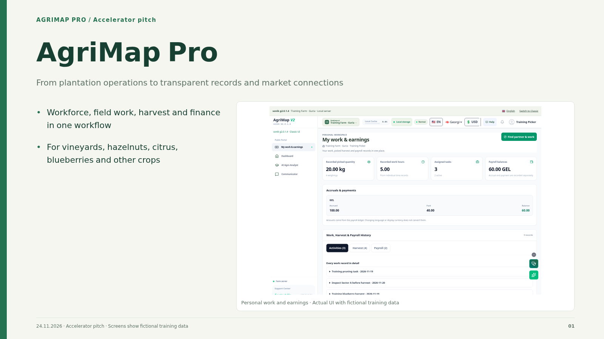

# AgriMap Pro — English Accelerator Pitch

**24 November 2026 · 16 core slides + 3 technical appendices · approximately 15 minutes for the core pitch**



- [PDF](AgriMap-Pro-Accelerator-Pitch-en.pdf)
- [Editable PowerPoint with speaker notes](AgriMap-Pro-Accelerator-Pitch-en.pptx)
- [English speaker notes](SPEAKER-NOTES-en.md)
- [Browser presentation](index.html)
- [English market-sharing concept](market-sharing-prototype.html)
- [Editable slide model](deck-en.json)
- [Screenshot sources](screenshot-sources.json)
- [Source and readiness boundaries](SOURCES.md)
- [Matching Georgian edition](../accelerator-ka/README.md)

This edition uses English slides, captions, speaker notes, controls and screenshots captured from the application's English mode. The Georgian edition uses Georgian UI captures. Training records are fictional; proposed prices, funding opportunities and planned features are not presented as achieved results. Team names are transliterations of the Georgian names supplied by the founder, not verified passport spellings.

## Rebuild

From the repository root:

```sh
npm run presentation:accelerator:en
```

To reproduce application screenshots after building the application: `npm run presentation:captures`. To regenerate the English concept: `node scripts/localize-market-prototype.mjs`, then `node scripts/capture-pitch-prototypes.mjs` to capture both concept editions.

The PowerPoint and PDF are standalone files. Browser slides rely on the relative `documents/` directory structure. PDF fonts are embedded; Noto Sans Georgian is used for consistent editable PowerPoint typography in both languages.
