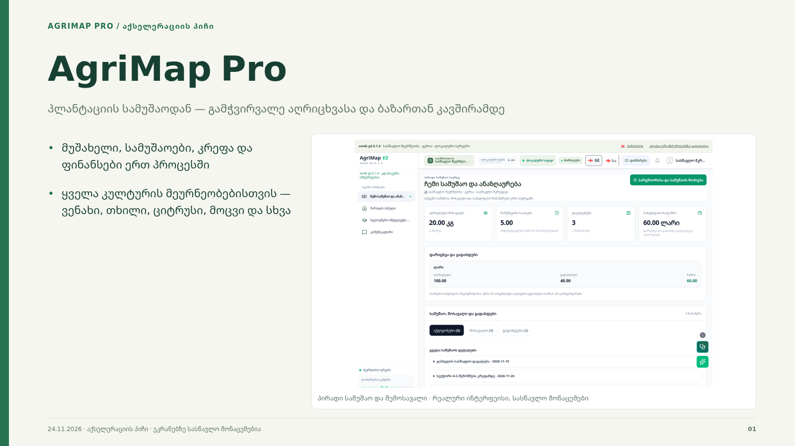

# AgriMap Pro — ქართული პიჩი აქსელერაციის პროგრამისთვის

**24 ნოემბერი 2026 · 16 ძირითადი სლაიდი + 3 ტექნიკური დანართი · ძირითადი ნაწილი დაახლოებით 15 წუთი**



- [PDF — პრეზენტაციის გასაზიარებელი ვერსია](AgriMap-Pro-Accelerator-Pitch-ka.pdf)
- [PowerPoint — რედაქტირებადი სლაიდები და მომხსენებლის ჩანაწერები](AgriMap-Pro-Accelerator-Pitch-ka.pptx)
- [მომხსენებლის ქართული ჩანაწერები](SPEAKER-NOTES-ka.md)
- [ბრაუზერის პრეზენტაცია](index.html)
- [ბაზრის გაზიარების ინტერაქტიული კონცეფცია](market-sharing-prototype.html)
- [რედაქტირებადი სლაიდების ტექსტი](deck-ka.json)
- [ეკრანის სურათების წყაროები](screenshot-sources.json)
- [წყაროები და ფაქტების გამოყენების საზღვრები](SOURCES.md)

[English edition — ინგლისური პრეზენტაცია ინგლისური ეკრანებით](../accelerator-en/README.md)

ქართული ვერსიის ეკრანები ხელახლა გადაღებულია აპლიკაციის ქართულ რეჟიმში, ქართული სასწავლო სახელებით. ტექნიკური კოდები, ბრენდები და ჯიშის სახელები ინარჩუნებს შესაბამის წერას.

## რა არის გათვალისწინებული

მრავალკულტურული პლატფორმა; პრობლემა და დაკავშირებული ბიზნესპროცესი; კრეფა და მუშის პირადი შემოსავალი; არსებული კომუნიკატორი და დაგეგმილი ბაზრის გაზიარება; მომხმარებლის სეგმენტები; შემოთავაზებული ფასები; გაყიდვებისა და ფერმერების ჩართვა; გუნდის ოთხი წევრი; პროგრამით გათვალისწინებული 25 000-ლარიანი გრანტის მიზანი.

გრანტის თანხა არ არის ხელოვნურად დანაწილებული და გუნდის გასაძლიერებლად ადამიანების რაოდენობა არ არის წინასწარ დაფიქსირებული. ფასი 150 ₾ თვეში და AI პაკეტები 10–150 ₾ მოცემულია როგორც შემოთავაზებული მოდელი; კომერციული შედეგებისა და არსებული ბილინგის მტკიცებულებად არ გამოიყენება.

სამი დანართი განკუთვნილია კითხვებისთვის: მოდულებს შორის მონაცემთა კავშირი; დაგეგმილი გაზიარების ავტორიზაცია; ღრუბლის, ადგილობრივი ქსელის, ოფლაინ რეჟიმისა და ინტეგრაციების საზღვრები.

## ინტერაქტიული კონცეფცია

გახსენით `market-sharing-prototype.html` ბრაუზერში. გადართეთ პარტიის რეჟიმი, საჯარო ან არჩეული მიმღებები, თითოეული კამერის ნებართვა და მყიდველის საცდელი იდენტობა. კონცეფცია არაფერს წერს აპლიკაციაში და რეალური კამერები არ არის დაკავშირებული. მასში ნაჩვენები კლიენტური ხილვადობა წარმოების უსაფრთხოება არ არის.

## განახლება

პროექტის ძირიდან:

```sh
npm run presentation:accelerator
```

PowerPoint-ში ტექსტი და დიაგრამები რედაქტირებადია, ეკრანები ჩასმულია. ერთნაირი ვიზუალისთვის გამოიყენეთ Noto Sans Georgian; PDF-ში შრიფტი ჩაშენებულია. ბრაუზერის პრეზენტაციისთვის შეინარჩუნეთ `documents/`-ის სტრუქტურა, რადგან რეალური ეკრანები საერთო გზამკვლევიდან იტვირთება.
