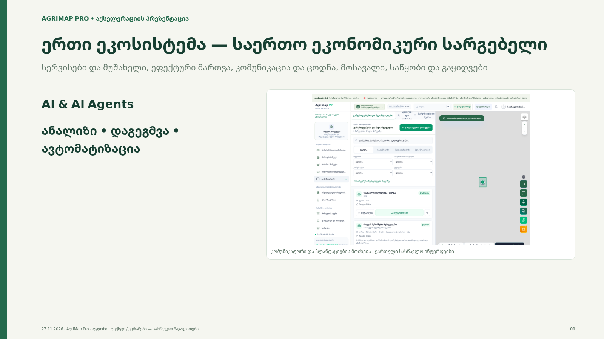

# AgriMap Pro — თქვენი ტექსტი, განახლებული დიზაინი

თარიღი: **27.11.2026**. ენა: ქართული. 15 სლაიდი.

- [PowerPoint — რედაქტირებადი პრეზენტაცია](AgriMap-Pro-Founder-Restyled-ka.pptx)
- [PDF — სანახავად და გასაზიარებლად](AgriMap-Pro-Founder-Restyled-ka.pdf)
- [ბრაუზერის ვერსია](index.html) — ჩამოტვირთეთ საქაღალდე ეკრანების საერთო საქაღალდესთან ერთად ან გაუშვით პროექტის ფაილების სერვერი.
- [მომხსენებლის ჩანაწერები](SPEAKER-NOTES-ka.md)
- [ანალიზი და რეკომენდაციები](REVIEW-ka.md)
- [ორიგინალიდან ამოღებული ტექსტი](source-text.json), [რედაქტირებადი მოდელი](deck-ka.json)
- [ტექსტის შენარჩუნების შემოწმება](text-validation.json), [ეკრანების წყაროები](screenshot-sources.json)

საფუძველია მომხმარებლის ატვირთული „AgriMap Pro — აქსელერაციის საპრეზენტაციო დეკი (1).pptx“. შენარჩუნებულია 15 სლაიდის თანმიმდევრობა და 187 ტექსტური ფრაგმენტი. შეიცვალა დიზაინი, განლაგება და დაემატა პროგრამის ქართული ეკრანები. არსებითი ტექსტური შესწორებები ავტომატურად არ განხორციელებულა; დასაზუსტებელ მტკიცებებს მცირე შენიშვნები ახლავს.

ეკრანებზე გამოგონილი სასწავლო მონაცემებია. ისინი ინტერფეისს აჩვენებს და არ ადასტურებს კომერციულ შედეგებს, რეალური მოწყობილობების კავშირს ან შესრულებულ AI დიაგნოზს. განსაკუთრებით, ნაჩვენები სასწავლო წონები არ არის 75 925 კგ შედეგის მტკიცებულება. ავტორის მიერ მოწოდებული ბიზნესციფრები დამოუკიდებლად არ გადამოწმებულა.

გამოყენებულია მშვიდი მწვანე/კრემისფერი დიზაინი და Noto Sans Georgian. PowerPoint-ში ტექსტი და ცხრილები რედაქტირებადია, ეკრანები — სურათებია. ზუსტი ვიზუალისთვის გახსენით PDF; PowerPoint-ის რედაქტირებისას დააყენეთ შესაბამისი შრიფტი.

ხელახალი გენერაცია: პროექტის ძირიდან `npm run presentation:founder`. საჭიროა პროექტის დამოკიდებულებები და Chromium. გენერატორი: [build-founder-restyled-presentation.mjs](../../../scripts/build-founder-restyled-presentation.mjs). ძველი პრეზენტაციები უცვლელია.
